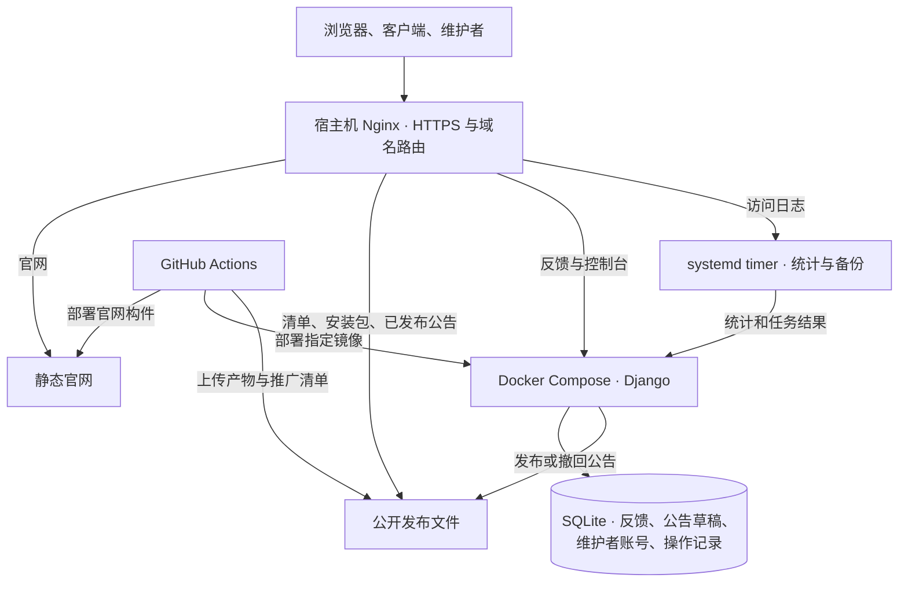
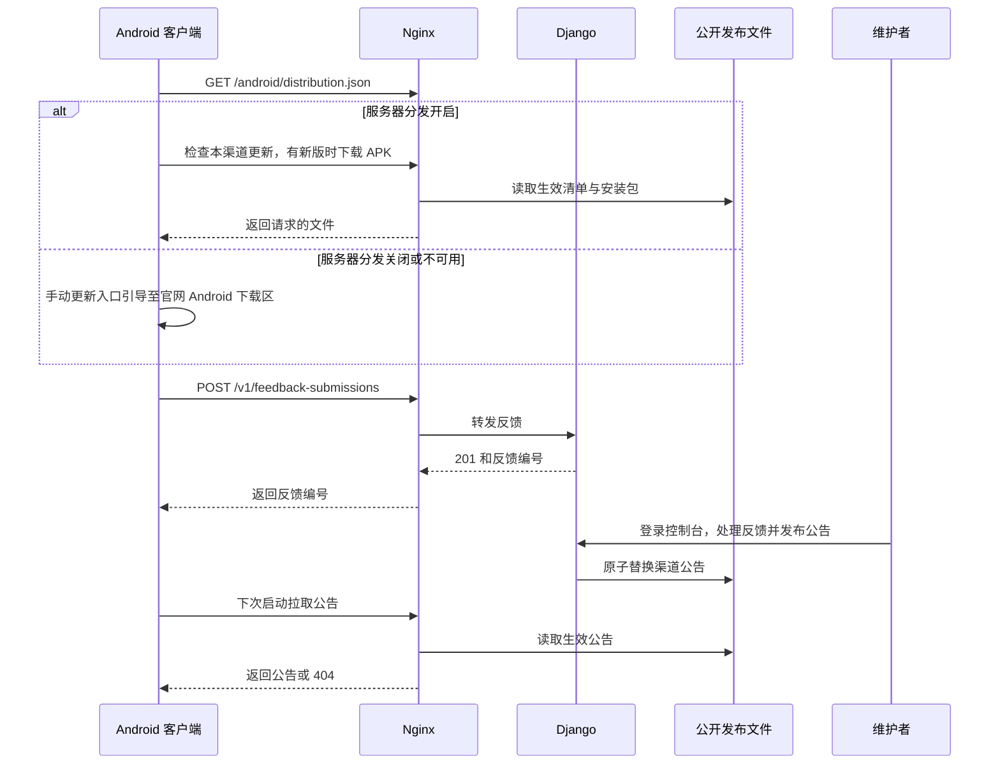
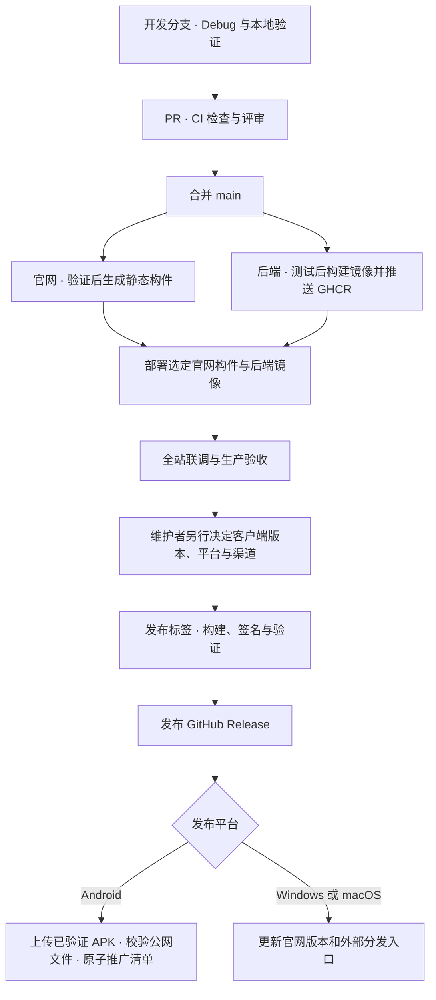

# LumaTile 服务端架构升级规划

状态：新旧域名已接入腾讯云并通过公网 HTTPS 检查，整体验收进行中。

本次升级把官网、更新分发、应用内公告、反馈和统计纳入一套可重复部署的生产架构。各模块可以并行开发，在整套服务部署并完成联调后，再由维护者决定何时发布客户端新版本。部署服务端和发布客户端分别触发，客户端版本、标签、签名和渠道清单的变更按[现有发布流程](../RELEASING.md)执行。

## 任务阶段清单

- [x] **阶段 1 · 确定契约。** 确定域名和路由、REST API 与 [OpenAPI 契约](../deploy/server/openapi.yaml)、Android 分发开关行为，以及旧客户端兼容范围。
- [ ] **阶段 2 · 并行实现。** 建设 Django API 与控制台，完成官网三端下载、桌面更新跳转官网和 Android 应用内更新及分发开关。
- [ ] **阶段 3 · 接通部署。** 配置 Nginx、HTTPS 和 Compose，接入官网、后端和 Android 更新源的 CI/CD，并配置统计、备份和告警。
- [ ] **阶段 4 · 整体部署与验收。** 统一联调三端下载、Android 分发开关和旧入口，验证反馈、公告、回滚与备份恢复。

阶段 2 和阶段 3 可以并行推进，阶段 4 统一验收。**正式客户端发版由维护者在验收后另行决定。**

2026-11-13 已在腾讯云启用官网、更新源、REST API、Django 控制台、统计和备份定时器。公网已验证 HTTPS、分发关闭时的 APK 拒绝、匿名访问控制台 API 的拒绝和反馈输入校验。

2026-11-14 已接通 `lumatile.ishua.cloud`，验证旧清单、公告与反馈入口，桌面 2.0.4 下载路径跳转到对应 GitHub Release 文件。剩余验收包括维护者登录、GitHub Actions 生产部署、站外告警、异机备份和客户端真机验证。

## 现状

| 模块 | 当前实现 |
| --- | --- |
| 官网 | `web/` 是独立静态站。下载页读取 Android 清单和旧桌面聚合清单，后者无法跟踪独立发布后的 Windows、macOS 版本。 |
| 更新分发 | Nginx 提供 Stable / Alpha 清单与安装包。GitHub Actions 构建发布产物，自建源另行上传和推广。 |
| 应用内公告 | 客户端启动时按渠道读取静态 JSON。现有发布脚本通过 SSH 上传 Stable 公告。 |
| 反馈 | Python 服务接收反馈并写入 SQLite，维护者在 `/admin/` 查看和处理。 |
| 统计 | Nginx 访问日志记录心跳和下载，Python 定时任务生成 `/stats/` 报表。 |

现有实现见[官网](../web/README.md)、[更新源](../deploy/update-source/README.md)、[反馈](../deploy/feedback/README.md)和[统计](../deploy/stats/README.md)。

## 域名与服务结构

| 域名 | 职责 |
| --- | --- |
| `lumatile.cn` | 官网、下载、更新说明、帮助和隐私说明。`/download/` 是各平台的统一下载入口。`www.lumatile.cn` 跳转到主域名。 |
| `updates.lumatile.cn` | Android 更新策略、各渠道的 APK 更新清单、APK 文件，以及三端的已发布公告。 |
| `api.lumatile.cn` | 客户端业务接口，使用 `/v1/` 管理接口版本，首期提供反馈提交。 |
| `console.lumatile.cn` | 维护者入口，提供反馈处理、公告发布、线上版本概览和运行状态。 |
| `lumatile.ishua.cloud` | 兼容旧客户端的公告、反馈和统计心跳。已公开的更新路径按需兼容，旧域名的 APK 下载同样受服务器分发开关控制。 |

- **Nginx** 直接提供官网和公开发布文件。更新清单与公告及时刷新，安装包按不可变路径缓存。官网跨域读取清单时需要更新源提供 CORS，并同步更新官网的 CSP 和下载地址校验。
- **Django** 以一个容器运行，按反馈、公告和维护者功能组织代码。API 和控制台共用进程，Nginx 按域名限制路由，Django 校验维护者权限。反馈接口沿用请求大小限制、字段校验和限流。首期使用 SQLite 持久化业务数据。
- **定时任务** 继续使用宿主机访问日志生成报表，由 `systemd timer` 调度。原始日志按站点轮转并限制访问。若下载后续接入 CDN，下载统计口径随日志来源重新核对。
- **数据边界** 反馈允许用户填写说明和联系方式，按需访问。教务登录、课表、成绩和 GPA 继续在客户端处理。使用统计保留客户端开关，首期沿用现有心跳协议。

腾讯云部署文件放在 `/srv/apps/lumatile/`，持久数据放在 `/srv/data/lumatile/`，官网放在 `/srv/www/lumatile/`。宿主机配置按 Nginx 和 systemd 的标准目录部署。仓库维护通用配置，服务器的 `/srv/ops/services/lumatile/` 记录实际路径、部署版本、检查和回滚步骤。凭据独立保管。

## 下载与应用内更新

| 平台 | 官网下载页 | 应用内点击更新 |
| --- | --- | --- |
| Android | 服务器分发开启时提供自建源 APK 下载，同时保留已配置的外部分发入口。关闭时仅展示外部入口。 | 先读取 Android 分发策略。开启时按本渠道清单检查、下载并校验 APK。关闭或自建源不可用时，手动检查入口引导用户打开官网的 Android 下载区。 |
| Windows x64、macOS arm64 | 按平台提供 GitHub Releases 下载链接、QQ群入口和百度网盘链接，以实际可用的已配置渠道为准。 | 更新按钮直接用系统浏览器打开官网对应平台的下载区，由用户选择渠道并下载安装包。 |

官网下载页维护各平台当前公开版本及渠道链接，桌面端的版本信息来自对应平台的发布记录。GitHub 链接指向对应平台的 Release，网盘与群内发布的安装包使用同一份已验证产物。正式下载链接在发布时填写。

### Android 分发开关

- 首次部署默认使用 `website`，由官网提供外部下载入口。整套验收后统一切换新旧域名到腾讯云，HTTPS 使用 Let’s Encrypt。
- 在控制台提供服务器 APK 分发的全局开关，可随时关闭或恢复，无需重新发客户端。官网和 Android 应用共用 `GET /android/distribution.json`，返回当前模式 `server` 或 `website`，以及官网 Android 下载页地址。策略响应使用 `Cache-Control: no-store`，每次检查重新读取。读取失败时，手动入口仍可通过客户端内置的官网地址继续。后台自动检查仅提供提示，由用户选择是否打开官网。
- 切到 `website` 后，官网隐藏服务器下载链接，Android 应用内入口引导至官网，Nginx 停止响应新旧域名上的 APK 下载请求，包括旧直链和断点续传请求。分发开关独立于发布清单和公告。切换时更新边缘路由并验证生效；若引入 CDN，同步停用或清除对应缓存，已开始的传输可能仍会完成。恢复后可继续提供同一份已校验 APK。
- 已安装的旧版客户端只能按原有逻辑处理下载失败。关闭分发时可配合现有应用公告指向官网。桌面旧版的桥接或手动安装路径在首次独立正式发版时决定。

## REST API 与静态资源

新业务 API 严格按 REST 设计。使用 `/v1/` 下的资源名与稳定 URI，集合用复数名，资源用标识符定位。`GET` 只读，`POST` 创建集合成员，`PUT` 幂等地设置指定资源，`PATCH` 部分更新，`DELETE` 幂等地删除资源。列表通过查询参数筛选和分页，响应包含可用的资源及分页链接。请求携带处理所需的认证和上下文，缓存行为显式声明。JSON 契约用 OpenAPI 描述，状态码遵循 [HTTP 语义](https://www.rfc-editor.org/rfc/rfc9110.html)，错误统一使用 [Problem Details](https://www.rfc-editor.org/rfc/rfc9457.html)。

| 业务 | 接口 | 响应 |
| --- | --- | --- |
| 提交反馈 | `POST api.lumatile.cn/v1/feedback-submissions` | `201 Created`，返回反馈编号。旧 `POST /api/feedback` 调用同一逻辑并保持原有响应。 |
| 查询反馈 | `GET console.lumatile.cn/v1/feedback-submissions?status=new` | `200 OK`，返回经筛选、分页的列表。仅维护者可访问。 |
| 更新反馈状态 | `PATCH console.lumatile.cn/v1/feedback-submissions/{id}` | 请求体如 `{"status":"resolved"}`，返回更新后的资源。 |
| 发布或撤回公告 | `PUT` 或 `DELETE` `/v1/channels/{channel}/active-announcement`（`console.lumatile.cn`） | `PUT` 将指定草稿设为该渠道的当前公告，`DELETE` 撤回当前公告。发布和撤回都记录操作人、渠道和时间。 |
| 设置 Android 分发模式 | `PUT console.lumatile.cn/v1/distribution-policies/android` | 请求体如 `{"mode":"website"}`。下载路由与公开策略生效后返回当前资源。 |

更新分发使用可直接读取的静态资源。以下路径以 `updates.lumatile.cn` 为入口，继续沿用客户端已有的清单和公告格式。

| 资源 | 路径 |
| --- | --- |
| Android 分发策略 | `GET /android/distribution.json` |
| Android 更新清单 | `GET /{channel}/android.json` |
| Android 安装包 | `GET /releases/{tag}/{file}` |
| 三端当前公告 | `GET /{channel}/announcement.json`，无公告返回 `404`。客户端按 ID 去重并检查有效期。 |

## 开发与 CI/CD

| 流水线 | 触发与部署方式 |
| --- | --- |
| 官网 | 官网相关改动合并后自动验证和打包。首次整体验收期间部署指定构件，整套上线后可启用合并自动部署。服务器保留版本目录，通过原子切换生效，入口检查失败时切回上一版。 |
| 后端 | 后端改动合并后自动测试和构建镜像，按镜像摘要手动部署生产。涉及数据库迁移时先做一致性备份，核对迁移与回滚的兼容性。部署后验证 API 和控制台。 |
| 客户端与更新源 | 继续按平台、渠道和标签构建签名。桌面版发布后更新官网版本和外部下载入口。Android 自建源推广由维护者手动触发，先上传不可变 APK 并校验大小和 SHA-256，再原子切换对应渠道清单。按现有流程更新 Android 备用清单。推广新版本时沿用当前分发模式。 |

生产部署使用受限账号与独立凭据。同一目标的部署串行执行。PR 和普通构建使用 Debug，正式签名继续走仓库现有流程。预演推广时使用隔离的清单目录和测试产物。公开包出现问题时，按发布指南停止推广并用更高版本修复。

## 实施与验收

以下是同一轮建设的工作项。表中的验收可以在同一次整体验收中完成。

| 工作项 | 交付 | 验收 |
| --- | --- | --- |
| 部署基础 | Nginx 域名路由、HTTPS、Compose、持久化目录和运行手册。 | 新域名证书与路由通过检查。Django 重启期间，官网、已发布公告和当前策略允许的下载仍可访问。 |
| 官网与更新 | 官网三端下载入口、桌面更新跳转、Android 自建分发和开关。 | 桌面更新按钮打开对应下载区。Android 开启时能验证并安装 APK。关闭后手动更新引导至官网、官网隐藏自建链接、新旧域名直链停止传输，外部分发入口可用。恢复后同一 APK 可重新下载。 |
| API 与控制台 | REST 接口、维护者权限、公告发布、Android 分发策略和版本概览。 | 新旧反馈接口均返回编号，按 OpenAPI 验证新接口的方法、状态码和权限。控制台可发布、撤回公告及切换分发模式。Android 版本取自生效清单，桌面版本取自平台发布记录。 |
| CI/CD | 官网构件、Django 镜像和 Android 更新源推广工作流。 | 从选定提交或产物复现部署，记录对应版本。验证官网和后端回滚，Android 推广只变更指定渠道的清单。 |
| 运维 | 站外探测、统计任务、备份、恢复与故障通知。 | 能发现官网、下载和 API 故障。验证统计按预期生成，并在隔离环境完成一次备份恢复。 |

整套服务部署后，用现有公开产物和隔离的测试数据完成联调。联调结束即可交付服务端，正式客户端发版时间由维护者另行决定。届时再按实际选择确认旧桌面桥接方案、平台版本、签名和 Stable / Alpha 发布开关。
